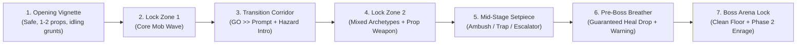

# Beat 'Em Up Stage Design Guide

> **Primary Reference Video:** [*Teenage Mutant Ninja Turtles: Shredder's Revenge — Full Game Walkthrough*](https://youtu.be/3xtrKOMcQgc) (beardbaer, Episodes 1–16)
> **Target Use:** Design & engineering blueprint for 2.5D belt-scrolling beat 'em up games on `retrogames4.net` (e.g., *HUNTRIX: K-Pop Demon Hunters*, *Streets of Neon*, and future arcade titles).

---

## 1. Core Design Philosophy

*TMNT: Shredder's Revenge* (Tribute Games / Dotemu) is a modern benchmark for 16-bit 2.5D arcade beat 'em up level design. Watching the full 16-episode progression in the reference walkthrough reveals five foundational principles that keep combat exhilarating without ever dragging:

1. **Short, Punchy Stage Runtimes (4–6 Minutes):** Each stage introduces *one* clear visual theme and *one* signature mechanical twist, escalates across 3–5 lock zones, and resolves with a memorable boss fight before fatigue sets in.
2. **Living Backgrounds (Diegetic World-Building):** Enemies do not merely walk in from screen edges—they interact with the environment (operating newsroom cameras, grilling hot dogs, lounging at Coney Island, tinkering in labs) until the player disrupts them.
3. **Two-Way Environment Interactivity:** Props and hazards belong to *both* sides. Hydrants, arcade cabinets, rolling barrels, electric fields, and snapping planks threaten careless players, but skilled players weaponize them by knocking or throwing enemies into hazards.
4. **Pacing Valves Across Stages:** Standard belt-scrolling brawls are regularly broken up by **forced-scroll hoverboard/skateboard stages**, **vertical/confined arenas**, **rooftop gap traversal**, and **boss-rush finales**.
5. **Instant Visual Readability:** Palette swaps immediately telegraph enemy archetypes (e.g., standard melee grunt, ranged projectile user, shield/block unit, rushdown attacker, aerial jetpack unit) so players make split-second crowd-control decisions even in chaotic rooms.

---

## 2. Macro Campaign Reference (All 16 Episodes)

Below is the pacing breakdown from the reference walkthrough, highlighting how stage archetypes, hazards, and boss styles alternate to avoid repetition:

| Ep. | Stage Title | Setting | Stage Archetype | Signature Gimmick / Hazards | Boss Archetype |
| :-: | :--- | :--- | :--- | :--- | :--- |
| **01** | *Jaw-Breaking News!* | Channel 6 Studios | Classic Belt-Scroller (Tutorial) | Smashable desks, cameras, monitors; low-risk onboarding | **Bebop** — Single charger + laser telegraph |
| **02** | *Big Apple, 3 PM* | NYC Streets | Classic Belt-Scroller | Interactive hydrants, traffic cones, parked cars (AOE explosions) | **Rocksteady** — Gunner + grenades + ramming charge |
| **03** | *Mutants Over Broadway!* | Broadway | **Forced Auto-Scroller (Skate/Hoverboard)** | Continuous forward movement, lane obstacles, aerial pizza balloons | **Turtle Tenderizer** — Vehicular boss crossing lanes |
| **04** | *Rumble in the Zoo!* | Central Park Zoo | Classic Belt-Scroller | Animal enclosures, interactive zoo props, flanking spaces | **Groundchuck & Dirtbag** — Duo boss (blind + bruiser) |
| **05** | *King of the Spill* | NYC Sewers | Hazard Belt-Scroller | Slippery slime lanes, toxic runoff, timed steam vents | **Rat King** — Summoner (rat swarms) + rush grabs |
| **06** | *Mall Meltdown* | Crystal Palace Mall | Multi-Plane Belt-Scroller | Escalators, smashable storefronts, arcade cabinets | **Tempestra** — Floating elemental zoner (lightning/fire) |
| **07** | *Roof Running Reptiles!* | NYC Rooftops | Platforming Belt-Scroller | Rooftop gaps (pitfalls), aerial jetpack Foot Soldiers | **Wingnut / Aerial Threat** — Flight patterns & projectiles |
| **08** | *Panic in the Sky!* | High-Altitude Skies | **Forced Auto-Scroller (Hoverboard)** | Aerial lane-dodging, sky hazards, flying formations | **Baxter / Airborne Encounter** — High-mobility aerial boss |
| **09** | *Crisis at Coney Island* | Coney Island Boardwalk | Hazard & Prop-Rich Scroller | Classic snapping loose boardwalk planks, carnival stalls, beach props | **Leatherhead** — Aggressive lunges, tail swipes, slams |
| **10** | *A Few Screws Loose* | Abandoned High-Tech Lab | Trap Corridor Belt-Scroller | Conveyor belts, laser grids, periodic security turrets | **Metalhead** — Mirror-match mimic cycling hero movesets |
| **11** | *Dinosaur Stampede!* | Dimension X / Prehistoric | Environmental Chaos Scroller | Stampeding hazards, alien terrain, heavy Triceraton guards | **Captain Zorax** — Heavy armored commander + plasma + shield |
| **12** | *It Won't Fly!* | Technodrome Hangar | Confined / Platform Arena | Assembly lines, elevated platforms, defense drones dropping hazards | **Baxter Stockman** — Mutated agile summoner/flyer |
| **13** | *Technodrome Redux* | Inside the Technodrome | Endurance Gauntlet | Tight corridors, high-density mixed elite waves, tech traps | **Technodrome / Elite Showdown** — Heavy armor & laser patterns |
| **14** | *The Lost Archenemies* | Dimension X | **High-Speed Hoverboard / Gauntlet** | Escalated obstacle speed + elite enemy remixes | **Returning Boss Remixes** — Dual/upgraded threat tests |
| **15** | *Outworld Strangeoids* | Outworld Hideout | Final Regular Gauntlet | All learned hazards combined; maximum enemy synergy | **Krang / Pre-Finale Boss** — Screen-control mech attacks |
| **16** | *Wrath of the Lady* | Times Square / Statue of Liberty | **Pure Boss-Rush Finale** | Skips regular trash waves; straight into multi-phase spectacle | **Statue of Tyranny → Super Shredder** — Giant setpiece + multi-phase duel |

### Scaling Down for Web / HTML5 Arcade Games (3-to-5 Stage Blueprint)
For browser-based retro games (such as those on `retrogames4.net`), compress the 16-episode arc into **3 to 5 tight stages** while preserving the exact pacing rhythm:

1. **Stage 1 — Onboarding Street / Rooftop (Classic Scroller):** Teaches 3-hit combos, Y-axis depth alignment, smashable food crates, and a single telegraphing mini-boss.
2. **Stage 2 — Interactive Hazard Zone (Mall / Subway / Alley):** Introduces environmental hazards (steam vents, electric cables, rolling objects) and mixed melee + ranged enemy compositions, ending with a Duo or Zoner Boss.
3. **Stage 3 — High-Speed Pacing Valve (Hoverboard / Express Train / Moving Elevator):** Shifts mechanics to forced-scrolling lane dodging *or* a cramped elevator survival arena with a vehicular/heavy boss.
4. **Stage 4 — Villain Lair Gauntlet (Optional for 5-stage games):** Conveyor belts, laser gates, elite enemies, and a mirror-match rival boss.
5. **Final Stage — Boss Showdown:** Brief dramatic approach + guaranteed full-heal pickup → 2-phase Final Boss (Phase 1 standard patterns, Phase 2 enraged at ≤ 50% HP with jumpable floor shockwaves).

---

## 3. Micro Stage Anatomy (Inside a Single Stage)

Every classic belt-scroller stage follows a **Tension–Release Wave Curve** divided into distinct beats along the X-axis (`WORLD_WIDTH`):



### Beat-by-Beat Design Rules
- **Beat 1 — Opening Vignette (0%–10% width):** Never ambush the player on frame 1. Give 1–2 seconds of free movement, 1–2 destructible props, and 2–3 low-HP grunts doing an idle animation so players immediately feel strong.
- **Beat 2 — Lock Zone 1 (15%–35% width):** Camera locks at `lockX`. Spawn 2 sub-waves: first wave introduces the stage's primary mob; second wave enters from *both* left and right edges to teach spatial awareness.
- **Beat 3 — Transition Corridor (35%–50% width):** Camera unlocks with a flashing `GO >>` indicator and chime. Place the stage's signature environmental hazard here in a low-pressure setup so players learn how it works *before* fighting beside it.
- **Beat 4 — Lock Zone 2 (50%–70% width):** Combine the stage hazard (or interactive throwable props) with a complementary enemy squad (e.g., 2 rushers + 1 ranged backliner + 1 heavy).
- **Beat 5 — Pre-Boss Breather (75%–85% width):** Reward players with a **guaranteed healing food drop** (e.g., Pizza / Ramyeon / Gimbap) inside an obvious destructible container (mailbox, vending machine, crate) right before the boss lock.
- **Beat 6 — Boss Arena Lock (85%–100% width):** Clear unnecessary visual clutter from the center floor so boss telegraphs, ground shadows, and shockwaves remain 100% readable. Trigger a brief `WARNING!!` banner and shift BGM to the Boss track.

---

## 4. Core Stage Archetypes & Mechanical Specs

### A. Standard 2.5D Belt-Scroller
- **Playable Depth Band (`Y` Axis):** Keep the walkable floor height at roughly **32%–40% of viewport height** (e.g., for `480×270`, `FLOOR_MIN_Y = 152` to `FLOOR_MAX_Y = 248`, giving `96px` of depth).
- **Hitbox Depth Forgiveness (`dy` Tolerance):** Use a generous `|e.y - p.y| <= 18..22px` for player attacks, and slightly tighter `<= 14..18px` for enemy attacks so the game feels responsive and fair.
- **Parallax Layering (5 Depth Planes):**
  1. Sky / Moon / Backdrop (`0.05×–0.15×` scroll)
  2. Far Skyline / Silhouette (`0.25×` scroll)
  3. Midground Buildings / Neon Billboards (`0.55×` scroll)
  4. Playable Street / Floor & Props (`1.0×` scroll — depth-sorted by `y`)
  5. Foreground Parapet / Lamp Posts / Guardrails (`1.15×` scroll — low opacity or bottom-edge framing only so action is never obscured)

### B. Forced Auto-Scroller (Hoverboard / Skateboard / Chase)
- **Reference:** Episodes 3 (*Mutants Over Broadway!*), 8 (*Panic in the Sky!*), and 14.
- **Core Loop Shift:** Camera scrolls continuously at constant velocity `scrollSpeed`. Player moves freely within screen bounds across 3–4 implied Y-lanes.
- **Telegraphed Lane Hazards:** Display a `0.6s–0.9s` warning arrow (`!` icon on the right edge at the hazard's exact `Y` coordinate) before high-speed cars, barriers, or missiles cross the screen.
- **Aerial Pickups & Scoring:** Place lines of score/meter pickups or healing balloons at jump height to encourage vertical movement and risk-reward play.

### C. Confined Elevator / Moving Platform Arena
- **Reference:** Classic TMNT elevator & hangar arenas (Episodes 12–13).
- **Space Constraint:** Zero horizontal scrolling; arena width equals 1 screen (`W`).
- **Spawn Variety:** Enemies drop from ceiling hatches (with visible landing shadows `0.5s` before impact) or enter from background elevator doors.
- **Combat Focus:** Rewards anti-air rising attacks, throws (tossing enemies into each other like bowling pins), and well-timed screen-clearing Specials when surrounded.

### D. Environmental Hazard Corridor
- **Reference:** Coney Island snapping planks (Ep. 9), Sewers steam/slime (Ep. 5), Rooftop gaps (Ep. 7), Lab lasers/conveyors (Ep. 10).
- **Golden Rule of Hazards:** Every hazard must have:
  1. **Visual Tell** (cracked plank color, hissing pipe steam, flickering laser emitter, floor caution stripes).
  2. **Rhythmic Cycle** (e.g., `2.0s OFF → 0.6s TELEGRAPH → 1.4s ACTIVE`) rather than random unfair bursts.
  3. **Friendly-Fire Utility** — knocking an enemy into a hazard deals bonus damage (`+20..35`) and grants style/combo score.

---

## 5. Interactive Props & "Living Background" Catalog

| Prop Category | Examples (*Shredder's Revenge* → Universal Theme) | Gameplay Function | Player Feedback |
| :--- | :--- | :--- | :--- |
| **Loot Containers** | Crates, trash cans, vending machines, newsroom monitors | Break in 1–2 hits; drop Food (HP), Special Energy, or Score items | Crisp hitstop, debris particles, item arc bounce |
| **Explosive / AOE Props** | Parked cars, fire hydrants, gas canisters, neon transformers | Triggered after 2–3 hits; flashes rapidly then explodes/sprays lane | Damages & launches nearby enemies; brief screen shake |
| **Kickable / Throwable Props** | Traffic cones, trash lids, barrels, stage speakers | Strikes send prop flying horizontally across the lane | Multi-hit knockdown bowling effect + combo extender |
| **Snap / Trap Props** | Loose boardwalk planks, floor shock pads, spring traps | Stepping triggers instant upward snap or knockback | Telegraphed visual cue; enemies can also be baited/thrown onto them |
| **Vignette Props** | Carnival booths, beach chairs, arcade cabinets | Enemies idle here before agro; smashing startles them into combat | Elevates charm and reduces repetitive "walk-in from edge" fatigue |

---

## 6. Enemy Wave Composition & Spawn Director Rules

To prevent frustrating "dogpiles" while keeping multi-enemy combat exciting, use a **Role-Based Wave Director**:

### Enemy Archetype Matrix
1. **Swarm / Grunt (e.g., Purple Foot Soldier / Imp):** Low HP, walks straight in, telegraphs melee strikes clearly. Primary combo fodder and meter battery.
2. **Ranged / Zoner (e.g., Yellow/White Foot / Archer / Banshee):** Keeps horizontal distance on the player's `Y` line, plays a distinct `0.45s` aim telegraph before firing a jumpable/dodgeable projectile.
3. **Rusher / Flanker (e.g., Dasher / Saja Trickster):** High horizontal speed, attempts to flank behind the player and execute a lunging strike.
4. **Heavy / Bruiser (e.g., Armored / Shield / Triceraton):** Blocks frontal light jabs or resists light hitstun; must be broken via Jump Kick, 3rd-hit Combo Finisher, Throw, or behind-the-back flanking.
5. **Aerial / Dropper (e.g., Jetpack Soldier):** Hovers above ground melee height (`z > 24`), vulnerable to Jump Kicks and Rising Anti-Air attacks.

### Crowd Control & Fairness Constants
- **Active Attacker Slot Cap:** Allow at most **2 simultaneous attackers** in `windup` / `atk` states (3 in late-game/co-op). Other enemies stay in `flank` or `orbit` states waiting for a token.
- **Flanking Slot Distribution:** Assign enemies alternating left (`-1`) and right (`+1`) flanking slots with slight `Y` offsets so sprites do not overlap into an unreadable stack.
- **No Off-Screen Cheap Shots:** Enemies must be fully inside the visible camera bounds (`camX + 16` to `camX + W - 16`) before they are allowed to initiate an attack windup.
- **Diegetic Spawns:** Mix spawn entry styles across waves—screen edge walk-ins, manhole/rift pop-ups, leaping down from rooftops, or bursting through background doors.

---

## 7. Boss Encounter Design Standards

Every stage culminates in a boss fight that tests the skills reinforced in that stage:

- **Readable Attack Loop:** `Positioning (1.0–1.5s)` → `Clear Telegraph + "!" Cue (0.35–0.5s)` → `Active Attack` → `Recovery / Punish Window (0.6–0.9s)`.
- **Anti-Stunlock Guard (Armor / Escape):** Never let the player infinitely stunlock a boss to 0 HP. After taking a full 3-hit combo or ~15% HP in one sequence, grant brief super-armor (`flashing` state) and trigger a telegraphed counter-dash, jump-back, or radial pushback.
- **Phase 2 Escalation (≤ 50% HP):**
  - Visual & audio cue (`ENRAGED!!` text, aura shift, faster tempo or boss roar).
  - Unlocks 1 new attack pattern (e.g., jumpable expanding floor shockwave, diagonal dash, or summoning 2 weak minions so players can rebuild Special/Encore meter!).
- **Special Meter Economy:** Bosses should drop or spawn occasional minions / hit-sparks so players can realistically charge at least 1–2 Super/Encore Specials during the fight.

---

## 8. Replayability: Stage Challenges & Score Bonuses

Borrowing *Shredder's Revenge*'s 3-challenge-per-episode structure gives arcade players clear mastery goals beyond simply surviving:

1. **Skill / Clean Play Challenge:** *"Take no damage from stage hazards"* or *"Defeat the boss without losing a life."*
2. **Mechanic Mastery Challenge:** *"Land a 15+ hit combo"*, *"Defeat 3 enemies with Jump Kicks"*, or *"Hit 3 enemies with a single Encore/Special."*
3. **Exploration / Prop Challenge:** *"Smash all glowing props in the stage"* or *"Find the hidden secret item/cameo."*

End-of-stage tally awards bonus leaderboard points for **Remaining HP**, **Max Combo**, **Time Clear Bonus**, and **Completed Challenges**, feeding directly into the `retrogames4.net` Hall of Fame (`POST /scores`).

---

## 9. Data-Driven Stage Schema (HTML5 Canvas Blueprint)

To scale browser beat 'em ups cleanly from 1 stage to multi-stage campaigns, separate **stage data** from the **combat engine** using a declarative config format:

```javascript
const STAGE_DEFINITION_EXAMPLE = {
  id: 'stage-2-neon-boardwalk',
  name: 'STAGE 2: NEON BOARDWALK',
  subtitle: 'MIDNIGHT CARNIVAL!',
  archetype: 'belt-scroller', // 'belt-scroller' | 'auto-scroller' | 'elevator' | 'boss-rush'
  worldWidth: 1680,
  floorBounds: { minY: 152, maxY: 248 },
  bgm: 'stage_neon',
  bossBgm: 'boss_theme',

  // Interactive props placed along the world X/Y coordinates
  props: [
    { id: 'crate-1', kind: 'vending-machine', x: 240, y: 160, hp: 20, drop: 'score-gem' },
    { id: 'hydrant-1', kind: 'explosive-hydrant', x: 640, y: 175, hp: 15, effect: 'lane-aoe', dmg: 35 },
    { id: 'food-boss', kind: 'ramyeon-cart', x: 1120, y: 168, hp: 15, drop: 'full-heal' },
  ],

  // Rhythmic or reactive two-way environmental hazards
  hazards: [
    {
      id: 'plank-1',
      kind: 'snap-plank',
      x: 520,
      y: 210,
      width: 28,
      height: 14,
      trigger: 'step',
      dmg: 14,
      affectsEnemies: true,
    },
    {
      id: 'steam-1',
      kind: 'steam-vent',
      x: 860,
      y: 166,
      cycle: { off: 2.0, telegraph: 0.6, active: 1.4 },
      dmg: 12,
      affectsEnemies: true,
    },
  ],

  // Camera lock zones & escalating sub-waves
  zones: [
    {
      name: 'WAVE 1 / 3',
      subtitle: 'BOARDWALK AMBUSH!',
      lockX: 0,
      subWaves: [
        [
          { type: 'grunt', x: 340, y: 185, entry: 'idle-prop' },
          { type: 'grunt', x: 400, y: 222, entry: 'walk-right' },
          { type: 'ranged', x: 430, y: 196, entry: 'walk-right' },
        ],
        [
          { type: 'flanker', x: 40, y: 205, entry: 'walk-left' },
          { type: 'grunt', x: 440, y: 178, entry: 'drop-sky' },
        ],
      ],
    },
    {
      name: 'WAVE 2 / 3',
      subtitle: 'HEAVY METAL CREW!',
      lockX: 540,
      subWaves: [
        [
          { type: 'heavy', x: 960, y: 200, entry: 'walk-right' },
          { type: 'ranged', x: 930, y: 168, entry: 'door-bg' },
          { type: 'flanker', x: 580, y: 228, entry: 'walk-left' },
        ],
      ],
    },
    {
      name: 'STAGE BOSS',
      subtitle: 'CYBER LEATHERHEAD!',
      lockX: 1200,
      isBossZone: true,
      warningBanner: true,
      subWaves: [
        [{ type: 'boss_stage2', x: 1560, y: 202, entry: 'leap-in' }],
      ],
    },
  ],

  challenges: [
    { id: 'no-hazard', label: 'Take zero damage from stage hazards', bonusScore: 1000 },
    { id: 'combo-15', label: 'Reach a 15-hit combo', bonusScore: 1000 },
    { id: 'prop-ko', label: 'KO an enemy using an explosive prop', bonusScore: 1500 },
  ],
};
```

---

## 10. Pre-Ship Stage QA Checklist

Before shipping any new beat 'em up stage on `retrogames4.net`, verify every item:

- [ ] **Depth Clarity:** Ground shadows clearly anchor every airborne player, enemy, and item to their exact `Y` combat lane.
- [ ] **No Softlocks:** Knocked-back enemies cannot clip permanently outside `[camX, camX + W]` and stall a camera lock zone.
- [ ] **Fair Telegraphs:** Every enemy strike, ranged shot, hazard cycle, and boss slam has a visible `>= 0.32s` telegraph before active hit frames.
- [ ] **Attacker Cap Enforced:** No more than 2–3 enemies attack simultaneously so solo players always have counterplay.
- [ ] **Pre-Boss Recovery:** A reliable healing pickup spawns or sits in a destructible prop before the boss zone.
- [ ] **Pacing Variety:** No two consecutive zones repeat the exact same enemy trio or layout gimmick.
- [ ] **Mobile & Desktop Parity:** All stage hazards (especially jumpable shockwaves and lane dodges) are comfortably playable using both keyboard (`WASD`/Arrows) and on-screen touch controls.
